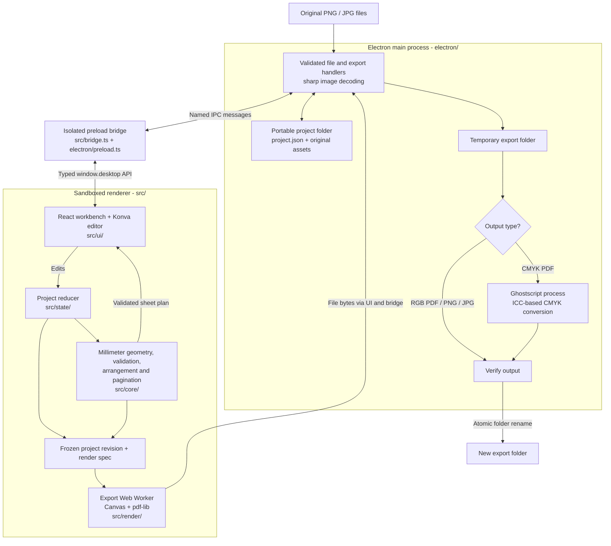

# dfCuts

**Prepare button-pin artwork and printable sheets, offline.**

dfCuts is a Windows desktop app for button-pin makers. Import PNG or JPG artwork, position it inside a circular template, set quantities, and arrange designs across printable sheets. Export physically sized PDFs or PNG/JPG sheets, then continue with your existing color-correction and printing workflow.

It was built around a small button-pin business spending too much time preparing artwork and duplicating designs manually in Canva. dfCuts handles positioning, wrap allowance, duplication, and sheet layout while preserving the original artwork.

**Target:** Windows 11 x64. The desktop workflow is implemented and covered by automated checks; physical printer calibration and installation on a fresh Windows machine still need acceptance testing.

[Open the app](#open-the-app) · [Clone and run](#clone-and-run) · [Architecture](#architecture) · [Licenses](#licenses)

## What it does

- **Edit artwork:** fit to the safe area or face, fill the face, drag, resize, rotate, and center. Resize handles appear when artwork is selected and hide when deselected.
- **Pick a background color:** use a pipette cursor with a source-pixel magnifier, or enter a color manually. Keyboard and touch picking are supported.
- **Lay out sheets:** choose A4, Letter, or custom paper; set margins, gaps, orientation, quantities, and an optional copies-per-sheet limit. Compare grid and staggered arrangements without shrinking the circles.
- **Export locally:** produce RGB or ICC-converted CMYK PDFs, or one PNG/JPG per sheet with resolution metadata. Screen guides and printed guides have separate settings.
- **Keep projects portable:** save settings, artwork edits, and original image bytes together. Move the whole project folder, reopen it, or relink missing sources without losing edits.
- **Recover safely:** cancel exports without replacing existing output, and choose Save and close, Discard and close, or Keep editing when closing an unsaved project.

One project uses one face/cut diameter pair and can contain multiple designs. The default is a **44 mm face / 53 mm cut**, giving **4.5 mm of wrap per side**. Other diameters are editable. Direct printing, mixed pin sizes on one sheet, cloud storage, and Canva integration are outside the current scope.

## Tech stack

[](https://github.com/tandpfun/skill-icons)

| Layer | Technologies | Purpose |
| --- | --- | --- |
| Desktop | Electron, Node.js | Window lifecycle, native file dialogs, project storage, and export coordination |
| Interface | React, TypeScript, Tailwind CSS, GSAP, local Geist font | Workbench, controls, styling, and navigation feedback |
| Artwork editor | Konva, react-konva | Interactive positioning, transforms, and editing guides |
| Rendering | Canvas / OffscreenCanvas, Web Workers, pdf-lib | Artwork tiles, sheet rendering, and RGB PDF / raster output |
| Image and color processing | sharp, Ghostscript | Oriented sRGB previews, image checks, and ICC-based CMYK PDF conversion |
| Build and packaging | electron-vite, Vite, electron-builder, NSIS | Development server, production bundles, and Windows installer |
| Verification | Vitest, Playwright | Geometry, validation, file safety, and real Electron workflow checks |

## Open the app

### From an installer

If you have a built installer, run `dfCuts-<version>-Setup.exe`, complete Setup, and open **dfCuts** from the Windows Start menu. The installed app works offline and does not require Node.js or npm.

Setup requests administrator access and installs the included Microsoft Visual C++ runtime for Ghostscript. To create an installer yourself, see [Build a Windows installer](#build-a-windows-installer).

### From an existing checkout

In PowerShell, open the repository folder. After completing the [first-time setup](#clone-and-run), use:

```powershell
npm run dev
```

This opens the Electron app with development reloads. To open the production build instead:

```powershell
npm run build
npm start
```

`npm start` requires a production build. Rebuild after source changes to see those changes in the production app.

## Clone and run

### Prerequisites

- Windows 11 x64.
- Git.
- Node.js 24 with npm.
- Internet access for the initial dependency and Ghostscript downloads. Normal app use is offline.

Run these commands in PowerShell:

```powershell
git clone https://github.com/GeoCeff/pinit-button-pin-formatter.git
cd pinit-button-pin-formatter
npm ci
powershell -ExecutionPolicy Bypass -File .\scripts\prepare-resources.ps1
npm run dev
```

The repository keeps its original `pinit-button-pin-formatter` name; the application is named **dfCuts**.

`npm ci` installs the versions recorded in `package-lock.json`. The resource script downloads the pinned Ghostscript 10.08.0 Windows archive, verifies its SHA-512 checksum, and extracts the engine, ICC profiles, and license notices into `resources/ghostscript/`. It does not run an installer or change system settings. Keep that folder for CMYK exports and packaging; it is intentionally ignored by Git.

If resource verification reports a missing `MSVCP140.dll` or `VCRUNTIME140.dll`, run `resources\ghostscript\vcredist_x64.exe`, complete its installation, and rerun the resource script. This Microsoft installer may require administrator access.

### First project

1. Follow or skip the first-run tutorial; **Help** reopens it.
2. Choose **Import artwork** and select PNG/JPG files.
3. Position each design, choose its fill color, and set **Copies**. Click the artwork to show resize handles; click outside or press **Escape** to hide them.
4. Open **Sheet** or **Setup** to adjust dimensions and arrangement. Review the sheet preview.
5. **Save** the portable project, or choose **Export sheets**, select the output options, and choose a destination folder.

Save and export are separate operations: saving preserves an editable project; exporting creates printable files. Exporting does not mark unsaved edits as saved.

### Build a Windows installer

After first-time setup:

```powershell
npm run dist
```

This typechecks and builds the app, verifies the offline resources, and creates an x64 NSIS installer in `release/`, named `dfCuts-<version>-Setup.exe`. Ghostscript, its generic CMYK profile, notices, and the Microsoft runtime installer are included.

### Commands

| Command | Purpose |
| --- | --- |
| `npm run dev` | Open the development app |
| `npm run build` | Typecheck and build production bundles in `out/` |
| `npm start` | Open the existing production build |
| `npm run typecheck` | Check TypeScript without building |
| `npm test` | Run geometry, validation, image, and file tests |
| `npm run test:desktop` | Check import, editing, saving, reopening, relinking, and RGB/CMYK PDF plus PNG/JPG exports |
| `npm run test:dev` | Check development startup and the production security policy |
| `npm run test:alignment` | Check dragging, resizing, selection, centering, and export overlays |
| `npm run test:eyedropper` | Check exact pixel sampling, magnifier, keyboard, and touch behavior |
| `npm run test:close` | Check close confirmation, save recovery, pending file operations, and export cleanup |
| `npm run dist` | Build the offline Windows installer in `release/` |

Run `npm run build` before the desktop, alignment, eyedropper, and close checks after changing source files. Prepare Ghostscript before checks that exercise CMYK output. Desktop checks use synthetic artwork, ignored `local-data/` folders, and isolated test profiles.

## Architecture

The renderer owns the interface and project edits. Electron owns filesystem access and native processes. A narrow preload bridge exposes named operations; the renderer has no direct Node.js or filesystem access. Physical geometry and validation live in shared TypeScript modules.



The diagram renders on GitHub. In Markdown viewers without Mermaid support, read the implementation map below.

- **Import:** Electron reads and validates source files. sharp produces oriented sRGB previews; original bytes stay available for project saving.
- **Edit and plan:** the reducer stores project settings and artwork transforms. The core computes sheet positions in millimeters; computed sheets are not persisted.
- **Render:** export captures the current project revision and sends a fixed render specification to a worker. Editor-only guides, handles, and the eyedropper overlay are excluded from the output.
- **Verify and publish:** Electron validates file bytes before staging, checks that all sheets are present, and converts and verifies CMYK PDFs in a separate Ghostscript process when requested. It publishes a completed export by renaming its folder. Failure or cancellation cleans up temporary output. Existing exports are never replaced, and failed CMYK conversion never silently falls back to RGB.
- **Close:** Electron requests an in-app confirmation when changes or an export are pending. Saving must succeed before Save and close proceeds; pending file operations and export cleanup are protected. An unresponsive renderer retains a native recovery prompt.

### Implementation map

| Location | Responsibility |
| --- | --- |
| `src/core/` | Units, artwork fitting, validation, packing, and pagination; independent of Electron and drawing libraries |
| `src/state/` | Project reducer and revision tracking |
| `src/render/` | Render specifications, shared canvas drawing, worker exports, and resolution metadata |
| `src/ui/` | Workbench, editor, library, settings, sheet preview, tutorial, and dialogs |
| `src/bridge.ts` | Typed renderer-to-desktop contract |
| `electron/` | Secure preload, native dialogs, source registry, project storage, staged exports, and color conversion |
| `scripts/` | Resource preparation, packaging checks, and Electron acceptance tests |
| `resources/` | App icons, installer integration, and locally prepared Ghostscript resources |

A saved project is a folder containing `project.json` and `assets/`. Keep them together when moving or sharing a project. Missing artwork retains its edits and can be relinked. Reusable presets copy settings into the current project without changing other projects.

For upgrade compatibility, the installation identity remains `app.pinit.desktop`, and existing settings stay in the `PinIt` application-data directory. Internal IPC channels and test environment variables retain their compatibility names. New project and export folders use `dfCuts-`.

## Print setup and data

Use measured face and cut diameters for your button machine. Print at **actual size / 100%**, check driver scaling and borderless expansion, and measure a calibration sheet before production use. Confirm the ICC profile and printed colors with the operator's workflow. Generating a PDF alone does not establish print accuracy.

Keep customer artwork, job data, and generated output in `local-data/`, which Git ignores. Other locations are not automatically protected from commits. Public samples should be synthetic or explicitly licensed.

<details>
<summary>Operator reference measurements</summary>

These values were supplied by the operator. Reported capacities still need checking against the actual template and printed output.

| Face diameter | Cut diameter | Reported circles per A4 sheet |
| --- | --- | --- |
| 58 mm | Not supplied | 12 |
| 44 mm | 53 mm | 18 |
| 32 mm | Not supplied | 28 |
| 25 mm | Not supplied | 48 |

The operator confirmed that the 53 mm cut matches the 44 mm button machine's opening. Other cut diameters must be measured rather than extrapolated from this pair. A rectangular grid of 53 mm circles on A4 holds 15; the reported 18 requires a different arrangement, such as staggering, checked against the real template.

The existing Canva intermediate is a 1254 × 1254 px PNG, high quality, transparency off, current page only. dfCuts does not require that intermediate size; physical geometry uses millimeters. The operator currently uses borderless A4 and adjusts color before printing.

Still needed for physical acceptance: the actual A4 template and margins/gaps, other cut diameters, printer model and driver settings, the downstream color-correction application, and the required ICC profile.

</details>

<details>
<summary>Current processing limits</summary>

Up to 500 designs/assets, 100,000 copies, 1,000 sheets, and 10,000 circles per sheet. Sources are limited to 40 megapixels and 50 MB each, with a 256 MB source/session budget. Rendering checks enforce a 256 MB raster/tile budget; custom profiles are limited to 16 / 64 MB per session; exported files are limited to 1 GB per job. Raster DPI must be a whole number from 1 to 2400.

PDF memory checks count artwork tiles. PNG/JPG checks count the full sheet plus artwork tiles. Printed-guide stroke widths are included in layout bounds. Start a new project to clear the source-session budget.

</details>

See [plan.md](plan.md) for workflow requirements, [AUDIT.md](AUDIT.md) for the implementation audit, and [ai-declaration.md](ai-declaration.md) for the AI assistance disclaimer. For a large contribution, open an issue describing the real layout problem before starting implementation.

## Licenses

| Component | License / notices |
| --- | --- |
| dfCuts source | [MIT License](LICENSE), copyright 2026 GeoCeff |
| Bundled Ghostscript runtime | GNU AGPL v3; bundled `ghostscript/doc/COPYING` and corresponding-source notice. Details in [third-party notices](THIRD_PARTY_NOTICES.md#ghostscript-10080). |
| Bundled Geist font | SIL Open Font License 1.1; full notice in [third-party notices](THIRD_PARTY_NOTICES.md#geist). |
| Microsoft Visual C++ redistributable | Microsoft's own license and notices; see [third-party notices](THIRD_PARTY_NOTICES.md#microsoft-visual-c-redistributable). |
| Other dependencies | Their respective licenses and installed-package notices; see [THIRD_PARTY_NOTICES.md](THIRD_PARTY_NOTICES.md). |
| README technology icons | [Skill Icons](https://github.com/tandpfun/skill-icons), MIT licensed; served by skillicons.dev. |

The source license does not replace bundled third-party licenses; the complete installer is not MIT-only. Customer artwork retains its own ownership and licensing.
