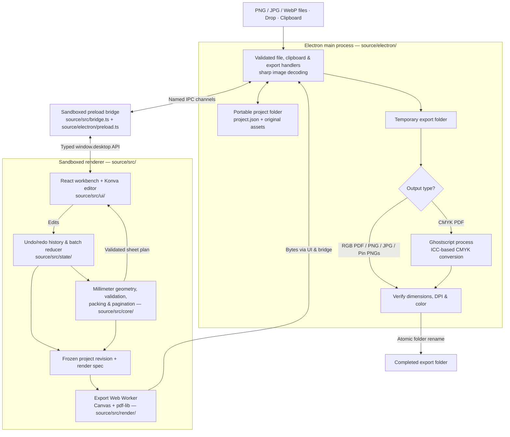

<p align="center">
  
</p>

<p align="center">
  <strong>Batch-format button-pin artwork and export print-ready sheets, completely offline.</strong>
</p>

<p align="center">
  <a href="https://github.com/GeoCeff/pinit-button-pin-formatter/releases/latest/download/dfCuts.exe"><strong>Download dfCuts.exe (Portable Windows x64 — No Install)</strong></a> ·
  <a href="#workflow-highlights">Features</a> ·
  <a href="#repository-layout">Repository Layout</a> ·
  <a href="#develop--build-locally">Build Locally</a> ·
  <a href="#licenses">Licenses</a>
</p>

---

## Download & Run (`dfCuts.exe`)

**No installation, Node.js, or internet connection required.**

1. Download the latest portable executable:
   **[Download `dfCuts.exe`](https://github.com/GeoCeff/pinit-button-pin-formatter/releases/latest/download/dfCuts.exe)** (or grab the checksummed release on the [Releases page](https://github.com/GeoCeff/pinit-button-pin-formatter/releases/latest)).
2. Put `dfCuts.exe` anywhere (Desktop, USB drive, or shop PC) and double-click to launch.
3. Everything — image processing, circular framing, sheet packing, PDF/PNG/JPG generation, and ICC-based CMYK conversion — runs locally on Windows 11 x64.

> **Auto-updated builds:** Every update pushed to `main` automatically runs tests, rebuilds `dfCuts.exe` via [`.github/workflows/release-exe.yml`](.github/workflows/release-exe.yml), and updates the `latest` GitHub Release. Running `npm run dist` locally inside `source/` also writes a fresh `dfCuts.exe` directly to the repository root.

---

## Why dfCuts Exists

Small button-pin shops often spend hours in Canva manually resizing circular designs, picking matching wrap colors, duplicating pins one by one onto A4 templates, and exporting pages separately.

dfCuts automates the entire prep workflow while preserving your original artwork files and giving you exact millimeter control over face diameter, cut diameter, bleed/wrap allowance, sheet arrangement, and color space.

---

## Workflow Highlights

### 1. Fast Artwork Import
- **Drag & drop** PNG, JPG, or WebP files — or drop an entire folder of designs at once.
- **Paste from clipboard** (`Ctrl+V`) directly into a project.
- **Preserve originals:** original image bytes are stored unchanged inside portable project folders (`project.json` + `assets/`).

### 2. Precision Pin Framing & Background Fill
- **One-click framing:** `Safe` (inside safe margin), `Face` (fit inside visible pin face), `Fill` (cover visible face), and `Bleed` (full-bleed cover across the entire cut circle).
- **Direct & numeric controls:** drag with optional center snapping (`Alt` bypasses snap), corner resize handles, mouse-wheel zoom, arrow-key nudging (`0.25 mm` / `1 mm` with `Shift`), `±90°` quick rotation, and `Flip H` / `Flip V`.
- **Smart background fills:** automatic edge-color detection on import, Apple-style Color Picker (Grid, Spectrum, RGB sliders, Hex, 12 saved swatches), and a pixel-magnifying eyedropper.
- **Full Undo / Redo** (`Ctrl+Z` / `Ctrl+Y`) across artwork edits and settings.

### 3. Batch Automation for Multi-Design Orders
- **Library batch bar:** apply `Safe` / `Face` / `Fill` / `Bleed` to every pin in one click, batch-set copy counts, apply edge-matched fills or the active color across all designs, duplicate variants, and see `< 200 PPI` print-resolution warnings before exporting.
- **Auto-fill remaining sheet space:** one click distributes copies into empty slots on the last sheet so zero paper goes to waste.
- **Interactive sheet preview:** click any pin directly on the preview sheet to jump straight to editing that design.

### 4. Print-Ready Output & Physical Calibration
- **PDF sheets:** RGB or ICC-converted **CMYK PDF** (powered offline by bundled Ghostscript 10.08.0 with generic or custom `.icc`/`.icm` profiles).
- **Raster sheets:** high-DPI `PNG` or `JPG` sheets with accurate physical DPI metadata (`pHYs` / JFIF).
- **Individual Pin PNGs:** export one circular PNG per active design at exact cut diameter and DPI.
- **100% Scale Calibration Sheet PDF:** one-click printable sheet with 100 mm horizontal/vertical rulers and your exact concentric face/cut test circle to verify printer scaling and cutter dies before a production run.
- **Printed options:** independent cut/face/safe circles, outer cut crosshairs, and optional bottom-margin job labels, plus 1-click **Open folder** and **Open file** right from the completion toast.

---

## Keyboard & Canvas Shortcuts

| Shortcut | Action |
| --- | --- |
| `Ctrl + Z` | Undo artwork or setting change |
| `Ctrl + Y` / `Ctrl + Shift + Z` | Redo change |
| `Ctrl + I` | Import artwork files |
| `Ctrl + V` | Paste image from clipboard |
| `Ctrl + O` | Open saved project |
| `Ctrl + S` / `Ctrl + Shift + S` | Save / Save project copy |
| `Ctrl + E` | Open Export dialog |
| `Mouse wheel` | Zoom artwork proportionally on canvas |
| `Arrow keys` / `Shift + Arrow` | Nudge selected artwork (`0.25 mm` / `1 mm`) |
| `Alt + Drag` | Move artwork freely without center snapping |
| `Escape` | Deselect handles or cancel eyedropper |

---

## Repository Layout

The repository separates the runnable artifact and documentation at the top level from all application source code:

```text
.
├── dfCuts.exe                   # Local portable build output from `npm run dist` (gitignored; live build in Releases)
├── README.md                    # Overview, download link, and quick guide
├── LICENSE                      # MIT license for dfCuts source
├── .github/
│   └── workflows/
│       └── release-exe.yml      # Auto-tests, builds, and updates dfCuts.exe on every push to main
├── source/                      # Application codebase, Electron shell, tests & packaging config
│   ├── electron/                # Main process, preload bridge, file validation, Ghostscript & calibration PDF
│   ├── src/
│   │   ├── core/                # Millimeter geometry, fitting, packing, pagination & project validation
│   │   ├── state/               # Project reducer, batch actions & undo/redo history
│   │   ├── render/              # Shared canvas drawing, DPI metadata & export Web Worker
│   │   ├── components/ui/       # Reusable UI controls (color picker)
│   │   └── ui/                  # React workbench, Konva editor, library batch tools & settings
│   ├── resources/               # App icon (.svg/.png/.ico), installer integration & local Ghostscript runtime
│   ├── scripts/                 # Resource prep, packaging scripts & Playwright Electron acceptance suites
│   └── package.json             # Dependencies, scripts & portable electron-builder configuration
└── docs/                        # Documentation, brand identity & archived design history
    ├── AUDIT.md                 # Implementation audit and verification scope
    ├── DESIGN.md                # Print workbench UI & interaction specification
    ├── PRODUCT.md               # Product constraints and scope
    ├── THIRD_PARTY_NOTICES.md   # Bundled Ghostscript, Geist font, and dependency notices
    ├── ai-declaration.md        # AI assistance disclosure
    ├── plan.md                  # Original system plan
    ├── brand/                   # Final Rail + Shift logo pack (.svg / .png)
    └── archive/                 # Archived early briefs, logo explorations, and inspiration files
```

---

## Develop & Build Locally

### Prerequisites
- Windows 11 x64, Git, and Node.js 24 (`npm`).
- Internet access once for `npm ci` and downloading Ghostscript 10.08.0 (all runtime operation is offline).

### Setup & Commands (inside `source/`)

```powershell
git clone https://github.com/GeoCeff/pinit-button-pin-formatter.git
cd pinit-button-pin-formatter/source
npm ci
powershell -ExecutionPolicy Bypass -File .\scripts\prepare-resources.ps1
npm run dev
```

| Command | Purpose |
| --- | --- |
| `npm run dev` | Launch Electron app with hot reload |
| `npm run build` | Typecheck and build production bundles in `source/out/` |
| `npm start` | Launch existing production build |
| `npm run typecheck` | Run TypeScript typechecking |
| `npm test` | Run Vitest core, history, file, and PDF unit tests |
| `npm run test:all` | Run unit tests, build, and all Playwright Electron acceptance suites |
| `npm run dist` | Build portable `dfCuts.exe` and copy it to the repository root |
| `npm run dist:installer` | Build an optional x64 NSIS installer in `source/release/` |

---

## Architecture



---

## Print Calibration & Limits

- **Always print at Actual Size / 100%** (disable "Fit to Page" or borderless expansion) and export a **Calibration Sheet PDF** first to verify both 100 mm rulers and your physical cutter die.
- **Starter pin sizes:** includes `44 mm face / 53 mm cut` (confirmed operator A4 default) and starter templates for `25 mm`, `32 mm`, `37 mm`, `58 mm`, and `75 mm` machines (`verify die` before bulk runs).
- **Processing bounds:** up to 500 designs/assets, 100,000 copies, 1,000 sheets, 10,000 circles per sheet, 40 MP / 50 MB per image within a 256 MB session source budget, and whole-number DPI from 1 to 2400.

---

## Licenses

| Component | License / notices |
| --- | --- |
| dfCuts source | [MIT License](LICENSE), copyright 2026 GeoCeff |
| Bundled Ghostscript 10.08.0 | GNU AGPL v3; bundled `ghostscript/doc/COPYING` and source notice. See [third-party notices](docs/THIRD_PARTY_NOTICES.md#ghostscript-10080). |
| Bundled Geist font | SIL Open Font License 1.1; see [third-party notices](docs/THIRD_PARTY_NOTICES.md#geist). |
| Other dependencies | Their respective open-source licenses in [third-party notices](docs/THIRD_PARTY_NOTICES.md). |

See [docs/PLAN](docs/plan.md), [docs/AUDIT.md](docs/AUDIT.md), [docs/DESIGN.md](docs/DESIGN.md), [docs/PRODUCT.md](docs/PRODUCT.md), and [docs/ai-declaration.md](docs/ai-declaration.md) for engineering details.
