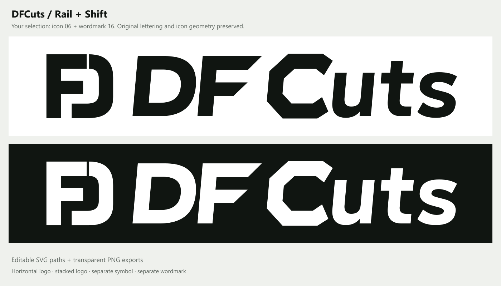

# DFCuts — Rail + Shift

Selected combination: **icon 06 Rail** and the **wordmark from 16 Shift**.



The standalone icon and wordmark preserve the selected concept files exactly. The horizontal lockup matches their visual weight and centers them on the same optical line, with clear space between the icon and lettering. The wordmark retains Shift's original slant and cut letterforms.

| File | Use |
| --- | --- |
| [logo.svg](logo.svg) | Primary horizontal logo, dark on transparent |
| [logo-reversed.svg](logo-reversed.svg) | White horizontal logo for dark backgrounds |
| [stacked.svg](stacked.svg) | Icon above the wordmark |
| [stacked-reversed.svg](stacked-reversed.svg) | White stacked logo |
| [mark.svg](mark.svg) | Selected Rail icon |
| [wordmark.svg](wordmark.svg) | Selected Shift wordmark |

Each SVG has a matching transparent PNG. Horizontal logos are 3200 px wide; stacked logos are 1600 px wide. The selected separate icon exports are 1024 × 1024 px, and the separate wordmark exports are 2600 px wide. White variants of the separate icon and wordmark are also included.

All logo lettering is outlined, so no font installation is required. Import the SVGs into Figma, Illustrator, Inkscape or another vector editor for editing.

To regenerate from the repository root, using the existing sharp dependency:

```powershell
node design/dfcuts-logo/build-logo.mjs
```

The builder verifies the exact source selection, transparent margins, unclipped artwork, and matching positive/reversed silhouettes. This is an asset pack; application integration is a separate change.
