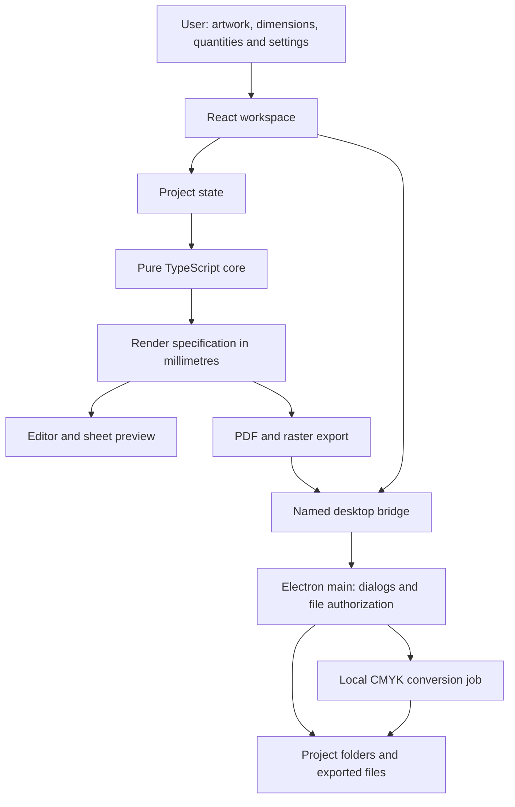

# Pin Sheet Maker product and system plan

**Platform:** Windows 11 desktop  
**Operation:** Offline  
**Primary users:** Button-pin makers, small print shops and anyone preparing sheets of circular artwork

**Implementation status (26 October 2026):** The M0–M3 application slices and M4 export/recovery/packaging code are implemented in this repository. Core/file tests and a real Electron desktop check cover RGB PDF, verified ICC-converted CMYK PDF, PNG/JPG density metadata, project portability, missing-source relinking and cancellation cleanup. The Windows installer is built through `npm run dist`; clean-machine installation and actual printer/profile calibration remain release acceptance checks. See README.md for commands and AUDIT.md for the audit. This plan's physical acceptance criteria remain requirements, not claims about a printed result.

## 1. Product objective

Build a desktop application that prepares circular artwork and arranges copies on printable sheets. Users import images, adjust their appearance, configure the inner and outer circles, select paper and layout settings, enter quantities, and export.

The application automates background fill, duplication, placement and pagination. Users retain control over image positioning, circle dimensions, paper, spacing, output quality and color mode.

Loyd's workflow provides the initial reference for the product. The application serves the same needs across different users and businesses through editable settings and reusable presets.

### First-release scope

- Import multiple JPG and PNG images.
- Independently customize inner-circle and outer-circle diameters.
- Resize, move, rotate and fit artwork within circular guides.
- Select background fill with an eyedropper or color picker.
- Repeat one design or mix designs with different quantities.
- Configure paper dimensions, margins, orientation and spacing.
- Choose grid, staggered or automatic arrangement.
- Set total quantities and an optional copies-per-sheet limit.
- Preview sheets and export PDF, PNG or JPG.
- Support RGB and CMYK PDF output.
- Save projects, preserve source artwork and reuse named presets.
- Install and run offline on Windows 11.

The first release uses one circle configuration per project. Mixed designs share that configuration. A new project or a different preset can use any valid inner/outer pair.

Artwork creation, business order management, cloud accounts, direct printer control and creative color correction are outside the first release. Exported files can be opened in other software for further editing or printing.

## 2. System architecture

Build one modular desktop application with a shared calculation core, an interactive workspace and separate output adapters.



### Responsibilities

| Module | Owns | Boundary |
| --- | --- | --- |
| Core | Validation, units, image transforms, circle layout, quantities and pagination | No UI, drawing, file access or Electron imports |
| Project state | Artwork references, edits and complete project settings | One source of truth; computed sheets are not a second editable model |
| Workspace | Image interaction, settings forms, selection and feedback | Converts user actions into project updates |
| Rendering | Shared artwork drawing and preview/PDF/raster adapters | Reads geometry from the core rather than recalculating it |
| Desktop bridge | Named operations for importing, saving, opening and exporting | Exposes specific capabilities rather than arbitrary system access |
| Electron main | Native dialogs, asset registry and safe file operations | Authorizes paths and jobs; keeps expensive rendering off its event loop |
| Color conversion job | ICC-based PDF conversion and output checks | Runs separately; preserves page geometry and layout |

**Core invariant:** the editor, sheet preview and export use the same dimensions, transforms and placements. Screen zoom changes the view, never the physical output size.

### Technology stack

| Concern | Technology | Purpose |
| --- | --- | --- |
| Desktop application | Electron | Windows 11 shell, local files and installer integration |
| Language and build | TypeScript and electron-vite | Shared types and a single development workflow |
| Interface | React | Workspace and settings |
| State | React reducer and context | Manage the project without an additional state library |
| Interactive canvas | Konva and react-konva | Image movement, scaling, rotation and clipping |
| PDF creation | pdf-lib | Explicit page dimensions, reusable image tiles and vector guides |
| Raster output | Canvas PNG/JPG encoding | Render images at selected pixel dimensions |
| CMYK conversion | Ghostscript behind a local adapter | Convert generated PDFs using a bundled generic CMYK profile or a user-selected ICC profile |
| Project storage | JSON manifest and copied image assets | Portable local projects without a database |
| Tests and packaging | Vitest and electron-builder | Core verification and Windows installer |

Use supported stable dependency versions and commit a lockfile. Package the conversion engine and required profiles with the application so standard CMYK export works offline without user setup. Include the applicable third-party licenses and notices in the installer.

### Data flow

1. Import an image and preserve its original bytes.
2. Decode its orientation and dimensions for editing.
3. Apply circle settings, image transforms, fill and quantities to project state.
4. Validate settings and calculate sheet placements in the core.
5. Build one rendering specification for preview and export.
6. Capture a project snapshot when export starts.
7. Generate the selected output, run CMYK conversion when selected, and save completed files.

## 3. Configurable circle model

Each project has two concentric circles and an optional safe guide.

| Element | Meaning | User control |
| --- | --- | --- |
| Inner circle | Front face or fold boundary | Any positive diameter |
| Outer circle | Cut boundary, including wrap allowance | Any diameter greater than or equal to the inner diameter |
| Safe guide | Optional inset inside the inner circle | Inset from zero up to less than the inner radius |

Inner and outer diameters are separate inputs. Changing one never silently changes the other. Both can be saved together as a named preset.

Store dimensions in millimetres. Support millimetres and inches in the interface, converting entered values to millimetres.

Derived values:

- Radial wrap allowance = `(outerDiameterMm - innerDiameterMm) / 2`.
- Safe diameter = `innerDiameterMm - 2 × safeInsetMm`.
- Placement spacing is based on the outer circle.

An example preset is **44 mm inner / 53 mm outer**, giving **4.5 mm radial wrap**. This is an editable example, not a fixed ratio or a restriction on supported sizes.

Preset names are labels. Calculations always use the saved numeric dimensions.

## 4. User workflow and settings

### Workflow

1. Create or open a project.
2. Select a preset or enter circle and paper dimensions.
3. Import one or more designs.
4. Fit, scale, move and rotate each image; choose its fill color.
5. Enter quantities and select sheet arrangement.
6. Inspect the image guides and generated sheets.
7. Save the project and export the selected format.

### Settings

| Group | Controls | Starting values |
| --- | --- | --- |
| Circles | Inner diameter, outer diameter, optional safe inset | 44 mm, 53 mm, 2 mm |
| Paper | Preset or custom width/height | A4, 210 × 297 mm |
| Paper description | Type and optional weight | Editable label |
| Margins | Top, right, bottom and left | Zero; standard-margin preset also available |
| Orientation | Portrait, landscape or auto | Auto |
| Arrangement | Grid, staggered or auto | Auto |
| Spacing | Gap between outer circles | 2 mm |
| Quantities | Total copies per design and optional copies per sheet | User-entered totals; maximum capacity per sheet |
| Mixing | Mixed designs or separate sheets | Mixed |
| Image fit | Whole image inside inner/safe circle, fill inner circle, manual | Whole image inside safe circle |
| Background | Eyedropper, custom color or white | Suggested edge color with manual override |
| Guides | Inner, outer and safe visibility; exported guides controlled separately | On-screen guides on; exported guides off |
| Export | PDF, PNG or JPG | PDF |
| PDF color | CMYK or RGB | CMYK |
| CMYK profile | Bundled generic profile or imported ICC profile | Bundled generic profile |
| Raster resolution | 150, 300, 600 or custom positive DPI | 300 DPI |
| JPG compression | Quality from 1–100% | 95% |

Implementation boundary: custom DPI is a positive whole number (1–2400). JPEG density fields are whole numbers, so fractional input is rejected rather than silently changing its physical interpretation. Documented batch, image and memory bounds also apply; invalid settings preserve the last valid preview.

Paper descriptions are project information. The user controls printer media and print quality in their printing software.

Presets copy values into a project. Later changes to a saved preset do not alter existing projects. Changing dimensions recalculates the layout and quality indicators while preserving image edits until the user chooses a reset.

## 5. Domain model and contracts

| Record | Contents |
| --- | --- |
| Project | Schema version, ID, name, revision, complete settings, assets and ordered designs |
| CircleSettings | Inner diameter, outer diameter and safe inset |
| PaperSettings | Width, height, orientation, four margins and media description |
| LayoutSettings | Arrangement, gap, mixing mode and optional per-sheet limit |
| Asset | Stable ID, project-relative source path, file type and oriented pixel dimensions |
| Design | Stable ID, asset ID, quantity, fit mode, transform and fill color |
| ImageTransform | Millimetres per source pixel, X/Y offsets in millimetres and rotation |
| ExportSettings | Format, color mode, DPI, JPG quality, guides, profile reference and rendering intent |
| SheetPlan | Computed page dimensions and slots containing design IDs and circle-center coordinates |

Original images and user settings are durable data. Sheet placements, thumbnails and screen zoom are computed or temporary data.

### Core interfaces

```ts
validateProject(project: Project): ValidationIssue[]
fitImage(asset: Asset, circles: CircleSettings, mode: FitMode): ImageTransform
buildSheetPlan(project: Project): Result<SheetPlan, LayoutError>
effectivePpi(transform: ImageTransform): number
buildRenderSpec(project: Project, plan: SheetPlan): RenderSpec
```

`RenderSpec` describes page dimensions, image placements, transforms, circle clipping, fills and guide drawing. Preview and output adapters consume this same specification.

### Desktop operations

Expose named operations for importing assets, opening/saving projects, choosing export destinations, starting/canceling export jobs and reporting progress.

The main process validates message sender, input shape, file references and payload size. Asset and destination IDs resolve to authorized paths. The renderer receives no generic filesystem or shell interface.

## 6. Core behavior

### Image fitting and fill

Normalize image orientation once. Preserve aspect ratio using a uniform physical scale.

For source width `w`, height `h` and target-circle diameter `D`:

- Whole-image fit: `scale = D / sqrt(w² + h²)`. The rectangular image's corners fit inside the circle.
- Fill-inner-circle mode: `scale = innerDiameterMm / min(w, h)`. Corners may be cropped.
- Manual mode: retain the user's scale, offsets and rotation.

Use the inner diameter or optional safe diameter for whole-image fitting. The user can enlarge the artwork and intentionally allow corners into the wrap area.

Paint the entire outer disk with the selected background before drawing the image. Clip the final artwork to the outer circle. The eyedropper samples the oriented source image rather than the already-filled background.

The starting fit is a geometric aid. Final positioning remains under user control.

### Layout and pagination

Let outer diameter be `d`, gap be `g` and pitch be `p = d + g`.

- Usable paper dimensions equal paper size minus the configured margins.
- Grid count per axis is `floor((usable + g) / (d + g))`.
- Staggered row pitch is `sqrt(p² - (p/2)²)`.
- Generate actual centers for shifted rows, both starting parities and both stagger directions.
- Auto compares supported arrangements and allowed orientations, choosing the highest capacity with a stable tie-break.
- Center the occupied layout inside the usable paper area.

Every outer circle must fit inside the usable area. Center distances must be at least `d + g`. Reserve space for any guide stroke extending beyond an outer circle.

Keep three quantities distinct: geometric capacity, the optional per-sheet limit and each design's requested total. Never shrink circles to force a count to fit.

In mixed mode, continue the next design in available slots. In separate mode, begin a new sheet for each design. Fill in stable design-list and row order, leaving unused final slots empty.

For capacity 18 and quantities A=20, B=7, mixed sheets contain 18 and 9 items; separate sheets contain 18, 2 and 7. A per-sheet cap of 10 produces 10, 10 and 7 occupied slots while preserving both design totals.

### Quality and validation

- Pixels = `mm / 25.4 × DPI`; PDF points = `mm / 25.4 × 72`.
- Effective source PPI = `25.4 / mmPerSourcePx`.
- Display actual source PPI and warn below 200 PPI while allowing deliberate export.
- Validate finite dimensions, positive diameters, outer >= inner, valid safe inset, nonnegative margins/gap and safe integer quantities.
- Treat zero capacity as a layout error before pagination.
- Check anticipated page counts and raster memory before allocation.
- Keep internal coordinates unrounded; round display values and raster allocations at their respective boundaries.

Higher export DPI increases output pixels; it does not restore detail missing from the source.

## 7. Export pipeline

### PDF

Create pages at the selected physical size using PDF points. Render each unique design from its source pixels at the selected raster resolution, embed it once and reuse it across placements. Draw selected guides as vector paths.

One adapter converts top-left project coordinates to PDF's bottom-left coordinates.

For CMYK output, convert the generated PDF in a separate local process using the selected ICC profile and rendering intent. Verify successful conversion, unchanged page dimensions and CMYK artwork before publishing the file. Save the profile identifier with export settings.

The default profile supports a complete export without device information. Users can optionally supply a profile for their own output workflow. The RGB editor preview represents layout and crop; it is not a print-color proof.

### PNG and JPG

Export one file per sheet using pixel dimensions calculated from paper size and selected DPI. Write and verify resolution metadata. Use a white sheet background initially.

JPG uses the selected compression quality. PNG is the lossless raster option.

### Job lifecycle

Allow one active export job. Use a frozen project revision, show progress and support cancellation. Render raster sheets sequentially and release buffers between pages.

Stage output before publishing it. A failed write, conversion or cancellation preserves the project and existing exported files. Report the failure and allow retry. Never silently replace a failed CMYK export with RGB output.

Users choose where files are saved and handle any subsequent correction or printing in their preferred software.

## 8. Persistence, safety and recovery

Each project folder contains `project.json` and an `assets/` directory holding preserved source images and any imported profile.

Use generated asset names and project-relative paths so the complete folder can be moved. Save assets before writing manifest references. Write the manifest to a temporary file, then replace the previous manifest only after a successful write.

Provide explicit save/open and an unsaved-changes prompt. When an asset is missing, retain edits and offer relinking. Reject unsupported project versions clearly.

Use Electron isolation, sandboxing, local content and restricted navigation. Validate file signatures, decoded pixel dimensions, path containment and desktop messages. Launch the fixed conversion executable without a shell and restrict it to authorized job/profile files.

Keep client artwork local. Avoid image contents and sensitive filenames in logs. Clean temporary job files without deleting original user files.

## 9. Interface structure

Use one workspace with:

- A design list showing thumbnails and quantities.
- A central image editor with inner, outer and safe guides.
- A settings inspector for circle dimensions, paper and artwork.
- A sheet-preview view showing capacity, occupied slots and page count.
- An export dialog for format, quality, color mode and destination.

Keep both circle diameter inputs directly accessible. Show invalid settings beside their fields and preserve the last valid preview until they are corrected.

Provide labeled controls, visible keyboard focus, numeric alternatives to drag gestures and clear progress/error messages.

## 10. Implementation milestones

Build complete slices in this order. Each milestone reuses the preceding implementation.

| Milestone | Deliverable | Completion criteria |
| --- | --- | --- |
| M0 Foundation | Windows 11 Electron/TypeScript project, domain types, unit conversions and validation | Core runs independently and numeric tests pass |
| M1 One design to PDF | Import, custom inner/outer circles, solid fill, whole-image fit and one-page PDF | Generated dimensions and crop match project settings |
| M2 Interactive editor | Move, zoom, rotate, eyedropper, guides and live settings | Edits appear consistently in preview and exported artwork |
| M3 Complete projects | Multiple designs, grid/staggered layout, exact quantities, pagination, presets and save/open | Single and mixed projects reopen with the same settings and quantities |
| M4 Release | CMYK conversion, RGB/raster options, progress/cancel, recovery and Windows installer | Acceptance checks pass and the installed app works offline |

M4 completes the first release. Additional image formats, mixed circle sizes on one sheet, mirror/blur fills and advanced editing can follow demonstrated user demand.

### Source organization

```text
pinsheet/
  electron/             main, preload, file operations and color-job execution
  src/
    core/               model, units, validation, transforms, layout and quality
    core/__tests__/     numeric, geometry and quantity tests
    state/              project reducer and actions
    render/             shared specification, Canvas artwork and output adapters
    ui/                 workspace, inspector, sheet preview and export dialog
  resources/            bundled profiles and required runtime resources
  test-fixtures/        reusable artwork and reference projects
```

## 11. Acceptance criteria

| Area | Required result |
| --- | --- |
| Custom circles | Changing either diameter updates guides, wrap allowance, layout and output without changing the other diameter |
| Paper and layout | Custom paper/margins/gaps are respected; no outer circles overlap or extend beyond the usable area |
| Image fitting | Whole-image mode contains source corners; fill/manual modes retain intentional cropping |
| Quantities | Every design exports its requested total in both mixing modes, with and without per-sheet caps |
| Preview agreement | Crop, fill, guides and placements match the selected export settings |
| Output dimensions | PDF geometry matches selected millimetres within 0.01 mm; raster pixels and resolution metadata agree |
| Color | CMYK output contains converted artwork; RGB output remains available; failures are explicit |
| Persistence | Reopening or moving a complete project preserves artwork, settings, transforms and quantities |
| Recovery | Invalid files, failed writes, canceled jobs and missing assets do not destroy project edits |
| Responsiveness | Editing stays usable during export; large jobs show progress and can be canceled |
| Installation | The app installs and runs offline on Windows 11 without development tools or hardware-specific setup |

## 12. Implementation references

- [Electron security](https://www.electronjs.org/docs/latest/tutorial/security) and [IPC](https://www.electronjs.org/docs/latest/tutorial/ipc)
- [pdf-lib document operations](https://pdf-lib.js.org/docs/api/classes/pdfdocument) and [page drawing](https://pdf-lib.js.org/docs/api/classes/pdfpage)
- [Konva high-resolution output](https://konvajs.org/docs/data_and_serialization/High-Quality-Export.html)
- [Canvas encoding and resolution metadata](https://developer.mozilla.org/en-US/docs/Web/API/HTMLCanvasElement/toBlob)
- [Ghostscript PDF conversion](https://ghostscript.readthedocs.io/en/master/VectorDevices.html) and [ICC settings](https://ghostscript.readthedocs.io/en/master/Use.html)
